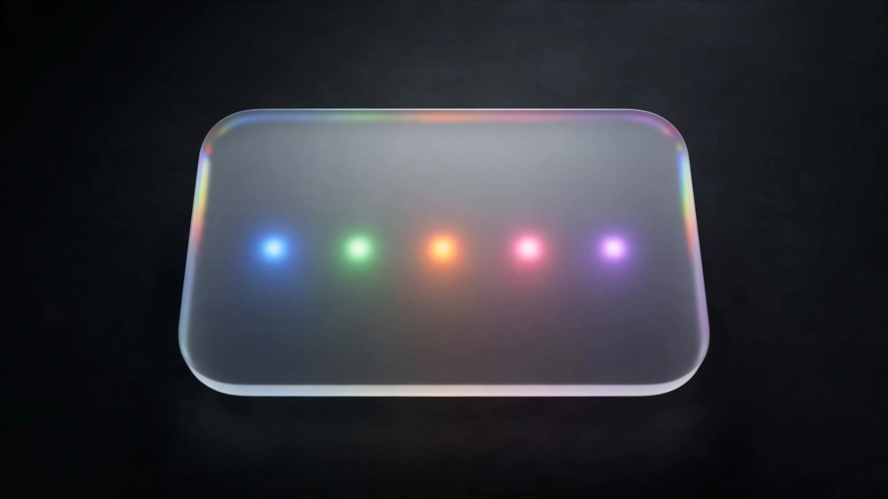

# hig-mcp — Apple HIG design tokens for AI coding agents

[](https://mcpservers.org/servers/aka-kika/hig-mcp)



**An MCP server that gives Claude Code, Cursor, and any MCP client the Apple Human Interface Guidelines as structured data** — real system color values, the type ramp, Liquid Glass constraints, and SwiftUI mappings — instead of prose to misread or stale hex to hallucinate.

## The problem every Apple dev (and their agent) has right now

At WWDC25 Apple didn't just ship Liquid Glass — it quietly **refreshed the system color palette** (HIG changelog, June 9, 2025). `systemBlue` is not `#007AFF` anymore. It's `#0088FF`.

Which means:

- **Every LLM's training data is wrong.** Ask an agent for iOS colors and it confidently hardcodes the pre-2025 palette.
- **The HIG is prose, not data.** Apple publishes guidelines as web pages; an agent burns thousands of tokens fetching one, then still guesses the numbers.
- **Liquid Glass has rules nobody wrote down in one place** — blur budgets, compositing layer caps, contrast measured *after* blur, the mandatory Reduce Transparency fallback. Agents violate all of them by default.

You end up reviewing generated SwiftUI that *looks* plausible and is subtly off-spec everywhere.

## How hig-mcp solves it

Curated, verified token files live **inside the server** — offline, deterministic, near-zero tokens — and prose is fetched live from [sosumi.ai](https://sosumi.ai) so guidance is never stale. Ask for `color` and you get the current post-WWDC25 spec table, not a 2023 memory.

| Tool | What it returns | Network |
|---|---|---|
| `hig_get_tokens` | Design tokens by category: color, typography, materials, layout, swiftui, sf_symbols | no |
| `hig_check_liquid_glass` | Liquid Glass guardrails + a concrete checklist for your context and platform | no |
| `hig_swiftui` | HIG component → the right SwiftUI API + which tokens to apply | no |
| `hig_fetch` | Current HIG page as clean Markdown (via sosumi.ai) | yes |

## How it works

Four tools over stdio (Python, the official `mcp` SDK 2.x). The structured half is plain JSON you own and extend (`src/hig_mcp/data/`); the prose half is delegated to sosumi.ai's DocC-to-Markdown rendering rather than rebuilt. Every value is provenance-tagged:

- `apple-system` / `apple-hig` — Apple-published facts (system colors, type ramp, 44pt hit targets).
- `wcag-aa` — the 4.5:1 contrast rule.
- `figma-effect` / `community-bestpractice` — useful numbers Apple never published, flagged so you know to confirm.
- `verify: true` — beta-era API names that shift; confirm via `hig_fetch` or Xcode before shipping.

Each data file also carries a `checked` date in its `_meta`: the day its values were last compared with Apple's live pages.

Honest data beats confident data.

## Quick start

```sh
pipx install hig-mcp
claude mcp add hig -- hig-mcp
```

Any MCP client, config form:

```json
{ "mcpServers": { "hig": { "command": "hig-mcp" } } }
```

`hig_fetch` targets `https://sosumi.ai` by default; override with `HIG_SOSUMI_BASE`.

## Built-in call counter

Every tool call appends one JSONL line — timestamp, tool, calling client (from the MCP handshake's `clientInfo`) — to `$XDG_STATE_HOME/hig-mcp/calls.jsonl` (override with `HIG_MCP_CALL_LOG`). So you always know which of your agents actually uses it:

```sh
jq -r .client ~/.local/state/hig-mcp/calls.jsonl | sort | uniq -c
```

## FAQ

**Why not just fetch developer.apple.com?** Prose costs tokens and still doesn't contain machine-usable values. Tokens here are instant, offline, and current.

**Does it replace sosumi.ai / apple-docs-mcp?** No — it deliberately delegates prose to them and owns only the structured layer they don't serve.

**What platforms?** iOS / iPadOS first, with the macOS type ramp and per-platform control sizes (iOS, macOS, tvOS, visionOS, watchOS). Values were last checked on **2026-10-17** against the live HIG and Apple's SwiftUI docs for OS 26 (shipping) and the OS 27 betas.

## Limits

Plain words on what this server is and is not:

- **Curated project data, not an Apple SDK.** The values are copied by hand from Apple's public HIG pages and docs, then checked. Apple does not publish them as data, and this project is not Apple's. If a value matters, confirm it in Xcode or the Apple Design Resources.
- **Beta-era names are checked as of 2026-10-17.** Liquid Glass and other OS 26 APIs were checked against Apple's docs on that date; anything marked 27.0+ comes from the OS 27 betas and can still be renamed before release. Those entries carry `verify: true`.
- **Some numbers are not Apple's.** The Liquid Glass blur and layer budgets, the spacing grid and the corner radii are community or Figma conventions. Each one says so in its `src` tag.
- **Prose needs the network.** `hig_fetch` downloads pages live from [sosumi.ai](https://sosumi.ai) (or your `HIG_SOSUMI_BASE`). Offline, or if sosumi.ai is down, the three token tools still work and `hig_fetch` returns an error.
- **It does not review your app.** It hands an agent the rules and the values; it does not look at your code or screenshots.

**A good pairing:** a full Apple docs server for API reference (for example [apple-docs-mcp](https://github.com/kimsungwhee/apple-docs-mcp) or sosumi.ai's own MCP), plus a HIG review tool that checks SwiftUI code and screenshots against the guidelines (for example [hig-review](https://github.com/nlaratta/hig-review)).

## Development

```sh
uv run --with pytest pytest -q
```

Changes per release are in [CHANGELOG.md](CHANGELOG.md).

## Legal

Apple, the Apple Human Interface Guidelines, SF Symbols, SwiftUI, and Liquid Glass are trademarks of Apple Inc. This project is not affiliated with or endorsed by Apple. No HIG prose is redistributed — `hig_fetch` retrieves pages live at runtime, and the bundled data files contain factual design values with original commentary. The MIT license covers this repository's code and data files only.

---

*Keywords: Apple HIG MCP server · Human Interface Guidelines · design tokens · Liquid Glass · SwiftUI · iOS 26 · macOS Tahoe · Model Context Protocol · Claude Code · Cursor · AI coding agents*
